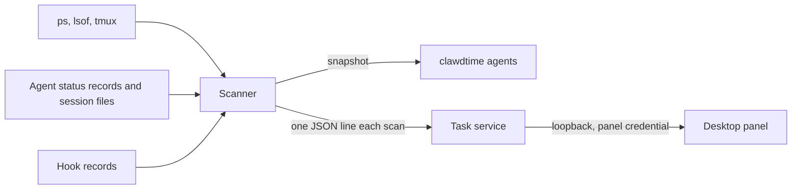

# Agent board

The agent board shows every coding-agent session on this Mac in one place: which
sessions wait for you, which ones work, and which ones are idle. One click, or
one command, brings the terminal of a session to the front.

The board is read-only. It reads state. It never sends keys or text to a
session, never answers a prompt, and never changes an agent's approval policy.

## Use it

In a terminal:

```sh
npm run build
node dist/cli/main.js agents                 # one listing
node dist/cli/main.js agents watch           # live board
node dist/cli/main.js agents focus NAME      # bring that terminal forward
node dist/cli/main.js agents --json          # the snapshot, for scripts
node dist/cli/main.js agents doctor          # how exactly each state is known here
```

In `agents watch`, the arrow keys or `j` and `k` move, Enter brings the selected
session forward, and `q` quits. `--all` also lists one-shot runs that have no
person at a terminal, such as `claude -p` and `codex exec`.

On screen: the [desktop panel](CODING_DEMO_DESKTOP.md) shows the same board above
the task area. A click on a row brings that session forward. When a session waits
for you, the toolbar line says so and the mascot shows the count. Start the panel
with `--tucked true` to open it as the mascot without taking focus. Start it with
`--agents false` to turn the board off, for example during a call qualification
run.

## States

| State     | Meaning                                              | Details                                             |
| --------- | ---------------------------------------------------- | --------------------------------------------------- |
| Needs you | The session cannot continue until you act.           | permission needed, question for you, plan to review |
| Working   | A turn runs.                                         | working, running a tool, background shell           |
| Idle      | The session waits for your next instruction.         | done, stopped on an error, interrupted, ready       |
| Unknown   | The session runs, but nothing reports its state yet. | no state signal, state not recognized               |

Sessions sort by state, then by time: the longest wait first, the most recently
finished first. "Background shell" means that the turn ended and only a shell
that the agent started still runs.

The board does not guess. A busy or quiet processor is never turned into a claim
about an agent. With no evidence the state is Unknown.

## How each state is known

| Agent              | Source                                                                                                    | Exactness                                          |
| ------------------ | --------------------------------------------------------------------------------------------------------- | -------------------------------------------------- |
| Claude Code        | Its own status record for each process, then `claude agents --json`                                       | Exact: working, permission prompt, question, idle  |
| Codex              | Its session file. With the hook: hook events                                                              | Turn state. Approval prompts only with the hook    |
| pi, dexter         | The last message of the session file                                                                      | Turn state: working or idle                        |
| Other agents found | Amp, Gemini CLI, opencode, aider, Cursor Agent, goose, Crush, Qwen Code, Copilot CLI, Droid: process only | Found, placed and focused. The state shows Unknown |

Evidence has a time. The newest evidence wins. At the same instant, the agent's
own report wins over what is read from its files.

Claude Code background sessions have no terminal. They come from
`claude agents --json` and cannot be brought forward.

### The Codex hook

Codex does not write an approval request to its session file. Without a hook, a
Codex session that waits for approval shows as Working. To show it as Needs you:

```sh
node dist/cli/main.js agents hooks install --agent codex
```

This adds seven events to `~/.codex/hooks.json` (`$CODEX_HOME/hooks.json` when
set) and changes no other hook. Codex runs a new hook only after you trust it:
open Codex and run `/hooks` once. `agents hooks status --agent codex` reports the
state, and `agents hooks uninstall --agent codex` removes only these entries.

The hook runs in the background and prints nothing, so Codex never waits for it.
It always exits 0. No hook fires when you approve a request. The board shows
Working again when a tool process starts under Codex after the request, or when
the next hook event arrives.

## Where focus lands

| Session runs in           | Focus goes to                                                      |
| ------------------------- | ------------------------------------------------------------------ |
| tmux                      | The window and pane, then the terminal of the attached tmux client |
| Terminal, iTerm2          | The exact tab                                                      |
| Ghostty 1.4 or later      | The exact tab                                                      |
| Ghostty before 1.4, other | The application. You choose the tab                                |
| Remote (ssh) session      | Nothing: its terminal is not on this Mac                           |

tmux needs no permission. Selecting a tab uses AppleScript: macOS asks once for
Automation permission for that terminal. Without the permission the application
still comes forward.

## Privacy

The snapshot holds structure only: agent, session name, project folder name,
working directory, state, times, process identifier, terminal and tmux location.
It never holds a prompt, a reply, tool input, command arguments or screen text.
Session names are cleaned of control characters and cut to 80 characters before
they reach a terminal or the panel.

A hook record is one small owner-only file for each session, under
`~/.local/share/clawdtime/agents/events/`. It holds the state, two times, the
working directory and three process identifiers. The file name is a hash of the
session identifier. The record is removed when the session ends.

The panel reads the board from the task service on loopback, with the same
private panel credential as the other `/desktop` routes:

- `GET /desktop/agents` returns the snapshot, or 503 when none is fresh.
- `POST /desktop/agents/focus` with `{"id": "..."}` brings that session forward.
  An id that is not on the current board focuses nothing.

## How it works



One scan lists processes, keeps the ones that match the agent catalog, reads
their working directories with one `lsof` call, reads the state evidence, and
places each session in its terminal and tmux pane. A scan of 13 sessions takes
about 0.1 seconds; the first one takes about 0.2 seconds.

For the panel, the scanner runs in its own process and prints one snapshot every
three seconds. The task service only keeps the latest valid line, so a scan can
never delay task, voice or presentation work. A snapshot older than three
intervals is not shown. If the scanner stops, the task service starts it again
after a delay that grows to one minute.

A new agent is one row in `connectors/agents/catalog.ts`. A state reader is
separate, in `connectors/agents/evidence.ts`. An agent with no reader is still
found, placed and focused.

## Limits

- Claude Code registers its status a few seconds after it starts. Until then,
  and while its folder trust question shows, the state is Unknown.
- A session file is matched to a process by working directory and start time.
  Two sessions of the same agent that resume old sessions in one folder can be
  matched to each other's file.
- pi and dexter show turn state only. A pi extension can add exact states later.
- Tab selection in Terminal, iTerm2 and Ghostty 1.4 is covered by tests with a
  recorded command runner. It has not been run against those applications. The
  tmux path and the application path are run for real.
- The board covers this Mac and this user. Sessions in containers, on other
  hosts, or under another user are not listed.
