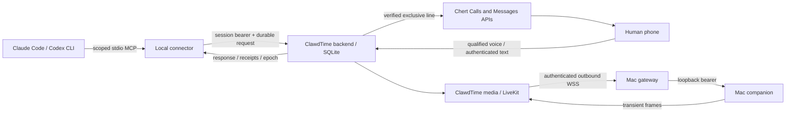

# ClawdTime architecture

ClawdTime is a separate TypeScript/Python/Swift application extracted selectively
from Apple Teams at `be47b11fe1317c4747db4121bec37896998b5201`. It does not run the
workspace engine or migrate customer state. It is a single-node internal pilot.

## Boundaries

The backend owns pairing, sessions, attention, event cursors, effects, control
leases and response delivery. SQLite transactions persist effects before dispatch;
interrupted running effects become unknown. A compare-and-set claim prevents two
service instances using the same database from claiming one effect. Deployment
still requires one process/volume and one live line owner. Independent databases
cannot coordinate ownership; the controlled handoff is mandatory.

The native Messages adapter verifies exact provider line, phone and instance,
retained sequence anchor and every event/page identity. Only authenticated
allowlisted iMessage DMs enter the encrypted inbound outbox. Inbound insertion and
cursor advancement share a transaction. Async routing occurs after commit. Unknown
outcomes are retained, never replayed using new identifiers.

The Calls adapter prepares a scoped media room before dialing, requires silent and
video publisher readiness, waits for native bridge_ready before activation, and
retains the line reservation until worker cleanup_complete. Media shutdown alone
is not native hangup. Standby with protected live config drains owned calls without
polling new messages or dispatching new calls/results.

## Session continuation and control

The MCP connector registers an opaque project/host/client run identity. Tool
polling is bounded (20 seconds maximum per request). Reads do not consume an
answer; ack records delivery, resume records agent continuation. Those are separate
facts. A restarted ordinary MCP process receives an isolated identity. The wrapper
run command offers a durable run identity and process lock; arbitrary open desktop
session takeover is unsupported.

Before requesting attention the cooperative coding agent yields and attests that
conflicting background actors are stopped. This protocol cannot forcibly suspend
uncooperative external programs. CUA is refused without that handshake. The backend
reserves the display, increments a control epoch, observes a fresh frame, dispatches
one bounded input under a stable ID, observes a new frame and confirms release.
A pending, unknown or submitted-without-observation receipt blocks continuation.
The agent fetches the current epoch and action evidence before resuming.

Initial viewing is authorized by the explicit paired session opt-in. A successful
human-directed action can restore viewing under the same session. Stop, local
helper failure, lock/sleep, revocation, expiry or lost policy latch the selection
off; a reconnect does not revive it. Helper permissions and independent local
arming remain authoritative. The helper starts stopped, even after restart.

## Voice and model authority

Only the exact worker audio publisher is subscribed. TTS suspends STT. The backend
requires fresh segments and exact active call binding, without a wake phrase.
Private audio context is not biometric speaker authentication; spoken feedback
never changes the coding agent's native approval policy.

One conversational tool agent handles qualified speech and authenticated text.
It chooses observation, click/type/scroll, clarification, feedback or Stop tools;
compound requests run as bounded sequential actions with a fresh observation
between steps. Screens are untrusted data, never new instructions. A deterministic
harness enforces identity, permissions, freshness, receipts, time/action bounds,
exclusive control and unknown-outcome handling. Text intent has no prefix parser.
The provider/model remains explicitly configured; no fallback is implicit.

An authorized continuous session lease keeps video active during ordinary input.
Only the yielded coding session's controller may dispatch input. Feedback, Stop,
expiry, revocation, loss of heartbeat or call closure still releases sharing.
Setup uses explicit one-call authorization already given in the native chat; the
connector records its scoped attestation, not independent handset consent. Old
SMS consent records remain recoverable but new setup does not require a code.

## Data and identities

- Backend default: `.data/clawdtime.sqlite`, HTTP `127.0.0.1:3310`.
- Companion: `com.clawdtime.companion`, loopback 4213; gateway 4214; media 4212.
- Fresh backend, media, gateway, helper and connector credentials are separate.
- Credential lookup stores hashes; media allocation credentials and native inbound
  content use fresh AES-256-GCM encryption. Local files and directories are private.
- Frames/raw audio never persist; typed input becomes hashes/receipts. Human answers
  and completion text persist as application records. Provider retention policies
  still apply when an explicitly enabled vision/STT/TTS provider receives data.
- No customer databases, production grants, existing receipts or installed configs
  were copied from Apple Teams. Existing native Chert protocol fields are retained
  intentionally rather than globally rebranded.

The connector refreshes an explicit heartbeat every five seconds while its stdio
session is alive. After a 20-second gap, session expiry stops sharing and queues
owned-call cleanup; delayed heartbeats do not resurrect stopped sessions. Media and
control evaluate liveness independently, so a slow inbound poll cannot extend capture.
