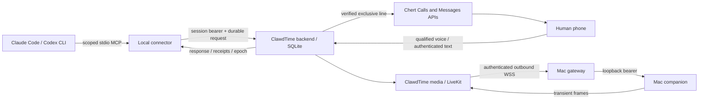

# ClawdTime architecture

ClawdTime is a separate TypeScript/Python/Swift application extracted selectively
from Apple Teams at `be47b11fe1317c4747db4121bec37896998b5201`. It does not run the
workspace engine or migrate customer state. It is a single-node internal pilot.

## Boundaries

The backend owns pairing, sessions, attention, event cursors, effects, control
leases and response delivery. SQLite transactions persist effects before dispatch;
interrupted running effects become unknown. A compare-and-set claim prevents two
service instances using the same database from claiming one effect. Deployment
still requires one process/volume and one live line owner. Independent databases
cannot coordinate ownership; the controlled handoff is mandatory.

The native Messages adapter verifies exact provider line, phone and instance,
retained sequence anchor and every event/page identity. Only authenticated
allowlisted iMessage DMs enter the encrypted inbound outbox. Inbound insertion and
cursor advancement share a transaction. Async routing occurs after commit. Unknown
outcomes are retained, never replayed using new identifiers.

The Calls adapter prepares a scoped media room before dialing, requires silent and
video publisher readiness, waits for native bridge_ready before activation, and
retains the line reservation until worker cleanup_complete. Media shutdown alone
is not native hangup. Standby with protected live config drains owned calls without
polling new messages or dispatching new calls/results.

## Agent-owned conversation (v2)

New connectors register `protocolVersion:2`; omission or explicit `1` preserves
legacy behavior. Registration binds version and capabilities immutably to the
exact project/host/client run. A reconnect cannot switch an existing call's brain.
The foreground JSONL bridge serves the existing chat; it is not a replacement
coding agent, client UI automation, or unsolicited message injection.

Qualified voice/text enters a bounded ordered turn inbox. The originating coding
session polls, acknowledges delivery, reports execution or pending native approval,
then publishes speech with stable reply IDs. Acknowledgement does not release
sharing or finish the request. Explicit end closes the call. A new turn received
during work waits in sequence; corrections are content for that same session.
Cancellation requests do not assert that a running native action was interrupted.

The legacy model is never called for v2 turns, even when native tools are unavailable.
`nativeControl` distinguishes none/browser/desktop and `sharedSurface` attests the
actual intended display surface. Default capabilities make no CUA claim. An
invisible browser context does not qualify the shared display. Normal tool
approvals remain the coding client's responsibility; phone speech cannot bypass them.

Call state, screen leases, turn state, and execution ownership are separate records.
An active v2 coding session can keep a view lease while reasoning/editing files.
Only conflicting shared-surface input claims native or ClawdTime ownership. A
compare-and-set epoch and explicit preceding completion attestation prevent stale
owners from dispatching; pending/unknown actions block handoff. This is cooperative
native ownership, not an OS-wide input interceptor.

The Mac securely stores local policy and its revision. It defaults to Agent tools
only; old `allowControl:true` is not fallback consent. Fallback also requires the
pairing permission, current exact session/call/display binding, local fallback mode,
matching revision and executor epoch, and fresh frame/receipt checks at every hop.
The same lease can change executor without replacing the video stream. Local
restriction or Stop cannot be overridden by backend telemetry. Screens and raw audio
stay transient; input text is hashed, not journaled.

Turn text is retained only while pending, bounded to 100 outstanding turns and
24 hours; terminal/uncertain outcomes redact it while preserving sequence and
fingerprint receipts. Reply text is transient; backend and media speech receipts
retain IDs/hashes/outcomes. Ambiguous playback is reconciled by GET, never a new
POST or new ID. The v2 inbound encrypted outbox payload is cleared once routed.
No duplicate unrestricted model conversation is stored.

Control Panel status travels over authenticated media→gateway→helper metadata.
Exact-session pause/mute/end commands return through readiness polling, persist an
intent before handling, and are acknowledged by stable ID. Sharing Stop is local
and immediate; native cancellation remains cooperative. Mute suppresses STT/TTS
while video continues. Half-duplex playback and bounded STT queues remain; full
barge-in is not promised.

## Legacy session continuation and control (v1)

The MCP connector registers an opaque project/host/client run identity. Tool
polling is bounded (20 seconds maximum per request). Reads do not consume an
answer; ack records delivery, resume records agent continuation. Those are separate
facts. A restarted ordinary MCP process receives an isolated identity. The wrapper
run command offers a durable run identity and process lock; arbitrary open desktop
session takeover is unsupported.

Before requesting attention the cooperative coding agent yields and attests that
conflicting background actors are stopped. This protocol cannot forcibly suspend
uncooperative external programs. CUA is refused without that handshake. The backend
reserves the display, increments a control epoch, observes a fresh frame, dispatches
one bounded input under a stable ID, observes a new frame and confirms release.
A pending, unknown or submitted-without-observation receipt blocks continuation.
The agent fetches the current epoch and action evidence before resuming.

Initial viewing is authorized by the explicit paired session opt-in. A successful
human-directed action can restore viewing under the same session. Stop, local
helper failure, lock/sleep, revocation, expiry or lost policy latch the selection
off; a reconnect does not revive it. Helper permissions and independent local
arming remain authoritative. The helper starts stopped, even after restart.

## Legacy voice and model authority (v1)

Only the exact worker audio publisher is subscribed. TTS suspends STT. The backend
requires fresh segments and exact active call binding, without a wake phrase.
Private audio context is not biometric speaker authentication; spoken feedback
never changes the coding agent's native approval policy.

One conversational tool agent handles qualified speech and authenticated text.
It chooses observation, click/type/scroll, clarification, feedback or Stop tools;
compound requests run as bounded sequential actions with a fresh observation
between steps. Screens are untrusted data, never new instructions. A deterministic
harness enforces identity, permissions, freshness, receipts, time/action bounds,
exclusive control and unknown-outcome handling. Text intent has no prefix parser.
The provider/model remains explicitly configured; no fallback is implicit.

An authorized continuous session lease keeps video active during ordinary input.
Only the yielded coding session's controller may dispatch input. Feedback, Stop,
expiry, revocation, loss of heartbeat or call closure still releases sharing.
Setup uses explicit one-call authorization already given in the native chat; the
connector records its scoped attestation, not independent handset consent. Old
SMS consent records remain recoverable but new setup does not require a code.

## Data and identities

- Backend default: `.data/clawdtime.sqlite`, HTTP `127.0.0.1:3310`.
- Companion: `com.clawdtime.companion`, loopback 4213; gateway 4214; media 4212.
- Fresh backend, media, gateway, helper and connector credentials are separate.
- Credential lookup stores hashes; media allocation credentials and native inbound
  content use fresh AES-256-GCM encryption. Local files and directories are private.
- Frames/raw audio never persist; typed input becomes hashes/receipts. Human answers
  and completion text persist as application records. Provider retention policies
  still apply when an explicitly enabled vision/STT/TTS provider receives data.
- No customer databases, production grants, existing receipts or installed configs
  were copied from Apple Teams. Existing native Chert protocol fields are retained
  intentionally rather than globally rebranded.

The connector refreshes an explicit heartbeat every five seconds while its stdio
session is alive. After a 20-second gap, session expiry stops sharing and queues
owned-call cleanup; delayed heartbeats do not resurrect stopped sessions. Media and
control evaluate liveness independently, so a slow inbound poll cannot extend capture.

## Optional activity presentation (version 1)

V2 polling/doctor advertise `capabilities.presentationVersion:1`. Connectors
negotiate per request before adding progress `presentation`; old servers receive
the existing progress shape. Activity decorates an explicit transition; it never
creates another task engine, grants input, satisfies approval, speaks, messages,
captures a screen or ends the call. Terminal outcomes use stable IDs and agent
verification (`agent_observed`, `not_verified`, `unknown`). The original chat can
summarize the existing poll/progress receipt itself.

Only per-turn IDs/fingerprints/verification and monotonic request ordering are
stored durably, with at most 19 intermediate identities plus one outcome per turn.
The original turn receipts remain intact. Text stays in one process-local cache:
100 requests globally, 20 summaries per request, ten minutes for activity and
60 seconds for outcomes. Capacity pressure drops optional text/metadata without
changing a human turn or effect. Terminal transitions clear interim text; Stop,
revocation, call closure, stale authority and expiry clear all retained text.
Replay never renews or restores it. Restart retains receipt metadata only.

The projection keeps newest delivery separate from active work: unresolved
outcomes take precedence, then an executing/approval turn, then the newest turn.
A queued correction cannot hide active work. Current summaries are separate from
bounded recent Details history. TS/Python/Swift share fixtures and reject Unicode
control/surrogate scalars, accepting valid ZWJ/astral text within 160 scalar and
640-byte limits. Panel telemetry expires after five seconds. Helper capability
negotiation preserves older components; malformed optional display data cannot
block local Stop or command acknowledgments.

Diagnostic conversation stages retain only process/correlation IDs and timing in
bounded memory (100 request timelines, 64 events each, ten minutes). Speech stages
extend the existing allowlisted media diagnostics. Correlations join causal
observations across processes; durations use only a single monotonic process and
generation. No backend dial timestamp is represented as handset ringing or visible
screen evidence. The fixture-first inspector exports only its explicit allowlist.
