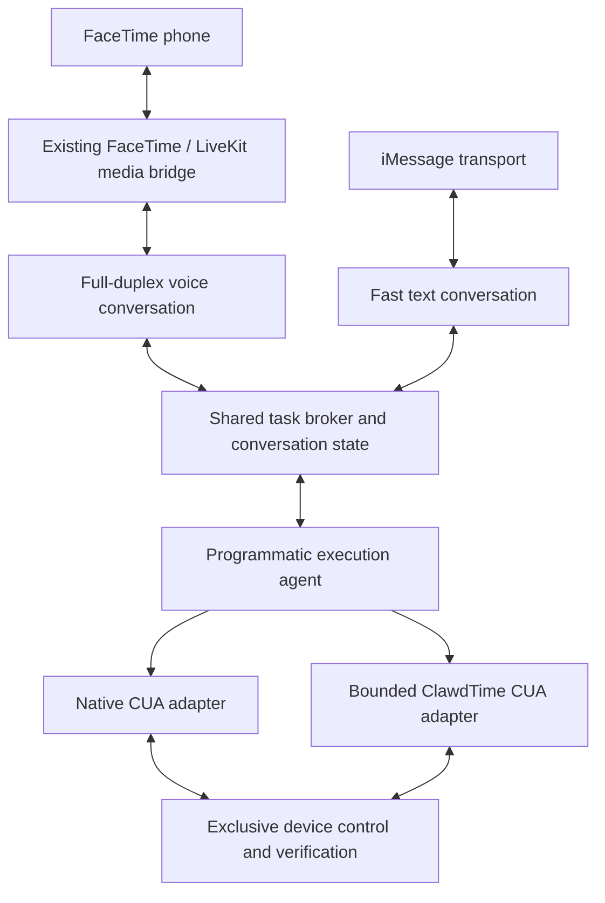

# Conversational control with asynchronous agent execution

Prepared November 13, 2026, America/New_York.
Status: user-approved direction; implementation handoff, not an implemented feature.
Keep this document uncommitted unless the user later requests otherwise.

## 1. Requested outcome and precedence

Give both FaceTime voice and iMessage a responsive conversational layer over a
shared **submit request → execute → verify → report** system. The execution agent
can use native CUA or ClawdTime's bounded custom CUA. Implement and measure both
eligible paths before selecting a default. Keep TypeScript, Python, Swift and
LiveKit. Do not replace the stack or assume screenshots are inherently faster.

The user rejected the current 30-second-scale voice experience as unusable.
Fast acknowledgments alone are insufficient: simple actions also need a faster
execution path, and long tasks need useful, truthful progress while conversation
continues.

This direction supersedes the older requirement that the original coding chat
generate every conversational answer. It also brings task submission from paired
iMessage into scope. It does NOT authorize arbitrary desktop-chat takeover,
replacement of a running task without disclosure, unrestricted model-generated
code execution, new line ownership, or unrelated public/multi-tenant features.
The selected execution session retains its identity, tools and approval policy.
Old instructions in SESSION_PROMPT.md and VOICE_INTERACTION_PLAN.md describe prior
phases; preserve their applicable safeguards, but do not rebuild their synchronous
voice-to-chat-to-speech architecture.

This handoff is for planning and subsequent implementation. Creating these files
does not place calls, send messages, install anything, change services or enable
capture. Existing user authorization persists where applicable; do not add routine
approval rituals. Physical prerequisites and specific new-call readiness still
require actual evidence.

## 2. Read and establish the actual baseline

Read applicable AGENTS.md files, IMPLEMENTATION_PLAN.md and SESSION_PROMPT.md,
then this plan, the latest sections of docs/STATUS.md, docs/VOICE_INTERACTION_PLAN.md,
docs/MEDIA_INTEGRATION.md, docs/CONNECTORS.md, docs/TRANSPORT.md, docs/DEVICE.md,
docs/DEPLOYMENT.md and LINE_HANDOFF.md. Historical documents are not current health
or deployment evidence. Reconcile contradictory dated paragraphs using source,
newer observations and fresh read-only checks.

At handoff:

- Local HEAD: `a5af1f3` on the existing `improvements` branch. Preserve this work;
  do not discard it to switch to main. Never create/use a `codex/` branch. Follow
  project instructions when choosing main or a generic descriptive branch.
- Backend release source: `7f1b687`, deployment
  `<deployment-id>`.
- Media startup fix source: `f7611d2`, deployment
  `<deployment-id>`. Python source matched the deployed files.
- `a5af1f3` fixes local timing inspection; it is not a new hosted release.
- The prior foreground test bridges were closed. Do not reuse their stopped
  sessions, task approvals or call identifiers for new effects.
- Last reconciliation: zero active calls/media sessions, pending effects and
  unknown transport effects; gateway connected. Recheck before live work.
- `docs/NATIVE_PHONE_CONTROL_DEMO_PLAN.md` was already untracked. Preserve it;
  remote iPhone control is a separate proposal and is outside this plan.

The first call failed with provider detail `bridge_remote_audio_timeout`: the
worker required audible agent output within ten seconds while v2 started silently.
The deployed fix sends one short, policy-bound connection greeting, with bounded
waiting and cancellation. Retain this compatibility requirement in the new voice
adapter; do not reintroduce silent bootstrap or duplicate greetings.

After the fix, a call lasted approximately 134 seconds until the user hung up;
provider state was `remote_ended` with confirmed cleanup. Basic speech in both
directions passed. The user confirmed receiving an earlier iMessage `BLUE` reply.
Full-duplex echo/interruption acceptance did NOT pass: those gates remained off.
No shared-screen CUA action was performed during the second call because the
requested field was ambiguous. A separate local Calculator trial verified input.

| Measured boundary                        | Observation                                   | Limit                                                 |
| ---------------------------------------- | --------------------------------------------- | ----------------------------------------------------- |
| Backend final turn → host acknowledgment | 8.635 / 10.368 / 15.030 s                     | Includes host scheduling/model/tool orchestration     |
| Connector poll HTTP                      | 99 ms median, 167 ms p95, 25 retained samples | Not total human response latency                      |
| TTS request → first audio publication    | 353 ms                                        | One retained correlated reply, not handset audibility |
| Native input + accessibility observation | 473–532 ms                                    | Small local trial, outside an active call             |
| Fresh source screen captures             | 184 in about 123.7 s, about 1.5 fps           | Encoded video frame count is not source freshness     |

Private, metadata-only evidence is in `.data/interaction-live-20261113/` and
`.data/interaction-rollout-20261113/`. Only the lead handles operational secrets;
do not print/copy credentials, runtime databases, conversations, audio or screens.

## 3. Target architecture

The execution runner may use a small bounded desktop workflow for simple actions
and the selected coding agent for longer work. These are routes inside the same
job/ownership system, not independent agents competing for the desktop. Ordinary
file/reasoning work can continue during screen sharing when it does not conflict.

### Conversation frontends

**Voice:** prototype GPT-Live (`gpt-live-1`) with client delegation through a
version-qualified LiveKit integration. It owns listening, speaking, clarification,
interruptions and conversational context; execution stays in our broker/runner.
Validate provider access and the installed SDK before choosing package changes.
The current media requirements contain LiveKit RTC/API packages, not the Agents
integration; this is real integration work, not a configuration-only toggle.

Important documented behavior to preserve:

- Client-delegation events provide delegation metadata, not a ready-to-run task
  argument object. Build a bounded request from actual conversation events and
  authoritative task state; don't execute an unstable partial transcript.
- The LiveKit GPT-Live integration is audio-only. Screen interpretation belongs
  in the executor; feed concise verified visual context back to conversation.
- GPT-Live has model-controlled turns. Do not reuse Realtime `response.cancel` /
  truncation assumptions without checking the actual GPT-Live interface. Local
  audio cutoff and application task cancellation remain separately enforced.
- Keep backend reasoning/tool instructions separate from the short voice prompt.

**iMessage:** use a fast text conversational model over the same bounded context,
intent validation and broker interface. Do not send text through a speech model
or generate TTS just to get a text answer. Ordinary questions and clarification
should not wait for the coding agent. Choose the text model from current provider
documentation and measured latency; expose an explicit configuration, not a
hardcoded claim that a particular model is universally fastest.

Conversation models propose intent. Deterministic application code validates
identity, capability, task revision, parameters and permissions before submission.
Neither frontend owns arbitrary shell/UI authority or native approval decisions.

### Shared context and cross-channel behavior

- Bind conversation to the authenticated member/pairing, selected project and
  execution session. A call is an optional attachment, not the whole task identity.
- Keep a bounded context containing recent conversation, active jobs, verified
  results and current screen-context age. Avoid dumping the coding transcript or
  private files into either conversational model.
- Order accepted voice/text instructions in one revision stream. A correction
  arriving by iMessage can supersede a voice request and vice versa.
- Deduplicate by actual channel event/delegation identity, not identical wording.
  Separately sent identical messages may be intentional separate requests.
- Give the chosen frontend ownership of conversational replies. Workers return
  structured progress/results; they do not independently speak and message the
  same result through parallel notification paths.
- Default result to the originating channel; send an additional recap or switch
  channels only under explicit user preference/policy. Coalesce progress.
- Persist operational receipts and task state minimally. Keep screen/audio
  transient, and avoid durable raw transcripts or user file contents in job logs.
  Redact terminal text under existing retention behavior; retain receipt metadata.
- A missing context after restart is a reason to request clarification, not infer
  and replay a task. Surface queued/blocked/unknown status honestly.

## 4. Broker and execution contracts

Define typed, versioned shared contracts before parallel implementation. The names
below are requirements to design, not claims of existing APIs:

- `submit_request`: validated intent, source event, conversation/session binding,
  revision, execution preference (`auto`, `native`, `custom`), scoped target and
  idempotency key. Durable acceptance returns a job ID and actual queued state.
- `request_status` / event subscription: accepted, queued, running, waiting for
  clarification/approval, succeeded, failed, canceled, cancel requested, unknown.
  Model cancellation and unknown effects explicitly; don't bury them in strings.
- `revise_request`: append a revision, invalidate stale future actions/results and
  preserve prior effects. Amend the intended job; don't restart every request.
- `cancel_request`: cancel queued work immediately; request cooperative stop for
  running work. Acknowledgment is not proof that an in-flight action stopped.
- `execution_result`: bounded summary plus verification/evidence metadata,
  timing references and unresolved effects. Success needs observed state.

Use existing storage/outbox patterns. Persist acceptance and dispatch intent
atomically. Maintain stable IDs across retries and restarts. An ambiguous provider
send, call or input must be reconciled under its original identity, never retried
under a new ID. Disconnect/reconnect must not dispatch an old queued correction or
restart a completed job. Serialize conflicting device jobs; allow independent
reasoning work where safe. Bound queues, revisions and retained metadata.

The caller should distinguish “I understood”, “queued”, “the agent started”, and
“verified complete”. No canned “working on it” that conceals an unavailable host.

### Execution connection feasibility is a first milestone

Prove a programmatic request → actual agent acceptance → progress → verified
result round trip. MCP is not a universal push channel into an idle desktop chat.
The foreground JSONL bridge also does not expose the current chat's native CUA
tools to another daemon. Polling faster inside that bridge does not remove host
model scheduling delays.

Prefer a documented persistent connection to the exact selected agent session.
If the current host cannot support it, implement an explicitly identified
API-managed execution session as a selectable runner; never claim it is the
original desktop conversation. Preserve existing connectors and project identity.
Do not launch a replacement coding agent invisibly, type prompts into a terminal,
or use a second MCP session to evade an unresolved effect. Mark unsupported
surfaces unavailable. Complete other implementation while documenting the exact
adapter prerequisite, rather than fabricating support.

### Native and custom CUA adapters

Both paths implement the same readiness, observe, propose-one-action, execute,
verify and release lifecycle. Tag which path actually ran every trial/job.

- Native: supported tools of the selected execution environment. Attest its
  actual visible surface and cancellation support; a hidden browser is not the
  shared Mac display. Don't assume the frontend can call this chat's CUA tool.
- Custom: reuse ClawdTime's fresh-frame, bounded action and Mac helper route.
  Ground actions from transient frames and suitable accessibility context where
  actually implemented. Do not execute arbitrary generated Python/AppleScript.
- Admit one bounded action at a time under exclusive ownership; reobserve and
  check corrections before the next. Fast desktop workflows may sequence such
  actions, with budgets and checks, rather than accept an unchecked model script.
- Before each input, check the current lease/epoch, instruction revision,
  interruption hold and surface freshness. Release or transfer ownership only
  after confirmed quiescence; an unresolved native action blocks transfer.
- Keep `auto` conservative until comparison trials pass. No native/custom race,
  and no fallback after an unknown submitted action. A backend switch requires
  reconciled prior effects and an explicit ownership transfer.
- If “the text box below” is ambiguous, obtain fresh app/target context and clarify
  promptly in the conversational layer. Never guess a destination or submit a
  message merely because a text field exists.

## 5. iMessage control without a FaceTime call

This is part of the requested design, not a reason to silently require a call for
every text task. Ordinary authorized file/reasoning jobs can run without sharing.
For device input without a call, implement an additive, explicit control grant
bound to member, device, selected session/project, permitted surface/actions,
expiry and current local Enable. Make call-bound and text-session-bound grants
distinct typed variants, not a fake call ID or removed call checks.

Local Stop, lock/sleep, revocation, stale authorization and session loss invalidate
the grant. Reconnect cannot rearm it. Reuse the same arbitration and freshness
rules for native/custom execution. Existing v2 call-only sessions retain their
recorded semantics. Negotiate new capabilities/version before a new session;
never upgrade an active session in place.

## 6. Audio, interruption and viewing

- Decouple continuous authorized input and output from worker execution and
  screenshot rendering. A slow worker/tool must not stall listening or playback.
- Use one speech owner. Disable old per-turn TTS for a session using the new voice
  model, including progress narration. Preserve legacy behavior for old sessions.
- On user interruption, stop local output promptly and discard obsolete queued
  audio. Distinguish quieting speech from “cancel the task”. Hold conflicting
  actions while a correction is being resolved; only finalized validated intent
  can dispatch an action.
- Qualify the real caller audio route and acoustic echo on speakerphone as well
  as headphones. Do not set `remoteAudioIsolated` merely to unlock a test. Provide
  an execution-disabled qualification mode if needed to observe duplex safely.
- Measure all output queues, including the external worker and handset. The
  worker's ring has five seconds of capacity, not measured five-second latency.
  If a required flush/ack capability is absent upstream, document the exact
  missing contract and request separately scoped work; do not edit the sibling.
- Preserve the deployed audible-startup requirement. Prove the new audio adapter
  satisfies it once without overlapping greetings or asserting it heard the user.
- Treat screen update latency separately. Inspect lease renewal, capture,
  encode/decode and composition timing. Reduce redundant work without weakening
  fresh policy, frame age, expiry or Stop. Repeated video frames are not new views.

## 7. Implementation sequence and ownership

Use a coordinating lead plus specialists as required by SESSION_PROMPT.md. Do not
delegate live line control. Use non-overlapping ownership; request shared changes
through the lead. Preserve existing unrelated work and both uncommitted handoff
files. Suggested waves:

1. **Context and feasibility:** lead records source/runtime baseline and final
   contracts; media specialist validates GPT-Live/LiveKit transport and lifecycle;
   connector specialist proves the programmatic runner and native-tool access;
   transport specialist maps text ingress, outbox and job persistence. Establish
   a runnable isolated vertical slice before broad refactors.
2. **Shared broker + iMessage vertical slice:** transport owns storage/attention/
   transport job state; lead owns public contracts/routes and fast text frontend;
   connector owns runner adapter. Demonstrate clarification → submit → progress →
   verified result, plus correction, cancellation, restart and unavailable runner.
3. **Voice frontend:** media specialist integrates the qualified full-duplex
   adapter with the same broker; lead integrates policy/version negotiation.
   Prove conversation stays responsive while a deliberately slow job runs.
4. **CUA and text-only grants:** lead owns control arbitration/authority; Mac
   specialist owns helper/gateway/media; connector owns native adapter. Qualify
   custom image/action handling without persisting frames. Measure comparable
   native/custom trials, then implement a documented selection policy.
5. **Acceptance and rollout:** independent cross-review of correction/unknown/
   interruption paths; lead runs integration, migration and rollout checks,
   records actual deployment/helper/adapter versions, and supervises live testing.

Respect AGENTS.md ownership: lead `src/contracts.ts`, `src/server.ts`, `src/app.ts`,
`src/control/`, scripts/public/root manifests and unassigned docs; transport
`src/storage/`, `src/transport/`, `src/pairing/`, `src/sessions/`, `src/attention/`,
backend tests and TRANSPORT.md; Mac `mac/`, `media/`, `gateway/` and assigned docs;
connector `cli/`, `connectors/`, skills, connector tests and CONNECTORS.md.

## 8. Measurement and acceptance

Record bounded metadata using monotonic time within each process, correlated by
conversation/job/revision/action and explicit capture/playback generations. Never
subtract unrelated clocks as a precise duration. Include failed, canceled, timed
out and unknown trials; do not report only successful fast trials.

Measure separately: input/utterance endpoint, conversation response start,
durable job acceptance, dispatch, actual runner acceptance, queue wait, inference,
ownership, observation, grounding, input submission, UI verification, first audio
publication, handset audibility, new source frame and handset visibility.
Retain enough bounded summary statistics that frequent event-loop samples do not
evict all useful speech/action pairs. Preserve the `a5af1f3` playback-generation fix.

Initial acceptance targets are engineering goals, not current capabilities:

| Boundary                                                       | Target and measurement condition                                     |
| -------------------------------------------------------------- | -------------------------------------------------------------------- |
| End of user utterance → first useful audible response          | p95 ≤2 s at handset                                                  |
| User interruption → output audibly quiet                       | p95 ≤300 ms at handset; record downstream tail                       |
| iMessage accepted by our ingress → reply submitted to provider | p95 ≤2 s for simple conversation; report handset delivery separately |
| Final accepted intent → durable job receipt                    | p95 ≤250 ms, application boundary                                    |
| Simple identified-field typing → verified visible result       | p95 ≤3 s, end-to-end controlled fixture                              |
| Long job                                                       | Conversation remains responsive; no false completion claims          |

Compare native/custom with at least 30 controlled trials per backend for supported
actions: click, type, scroll and one grounded action. Same machine, display,
fixture state, call condition and command; record model/tool versions, fresh-frame
age, success/correction rates, latency distribution and cost. Separate comparable
operations from capability gaps. Randomize/interleave order when practical.
Measure with and without active FaceTime. Select defaults from speed AND verified
success; no claim that the earlier Calculator samples are a complete CUA benchmark.

Required behavior checks:

- Voice and text can converse/clarify while a long job executes.
- Text and voice corrections share order and invalidate stale work/results.
- Stop speaking, cancel task and local Stop have distinct correct behavior.
- Duplicate delivery/reconnect/restart never repeats external effects.
- Native/custom exclusive control survives timeout; unknown input blocks handoff.
- Wrong session/member/device, expired grant, stale frame, lock/sleep and revoked
  permission refuse input. Queued work cannot revive an expired grant.
- Execution-disabled speakerphone qualification detects echo/false interruptions
  before live control; no stored raw audio/screens.
- Text-only CUA works under its real local grant, without fabricated call state.
- Result/approval questions remain tied to exact job and actual native policy.
- Handset tests establish audible/visible outcomes, not just transport receipts.

Run `npm run check`, relevant media/gateway suites, and Swift validation from
component READMEs for changed native code. Add meaningful tests for new lifecycle
and authority boundaries. Use synthetic fixtures for automated testing; a passing
mock does not satisfy physical acceptance. Update README/GUIDE/STATUS and skills
so agents use the new routing model and supported capabilities accurately.

## 9. Rollout and external boundaries

Default development to simulation/standby and feature flags. Negotiate the new
conversation/runner/control capabilities only on new sessions. Preserve old v1/v2
sessions, receipts and unknown outcomes. Stage source/config/migration validation
before touching deployed services; prepare rollback that preserves new job data
and does not replay the outbox or resurrect old call sessions.

Only the lead may handle secrets, install/restart components, deploy or own the
live line. Never modify the source project or the sibling private repository, or copy their runtime data.
Use the existing dedicated ClawdTime binding from protected configuration; older
Liam/line A handoff prose is not a new instruction to transfer a line. Recheck idle
ownership and unknown effects before rollout. No new paid plan/account/line is
implied. Existing authorization is not a reason to repeat confirmations, but a
new call needs actual user readiness and applicable call authorization; prior
test approvals must not trigger unattended redial.

Completion requires an implemented and validated shared voice/text broker,
working documented execution adapter, qualified native/custom control paths and
measurement report, deployment-ready migration/rollback, and honest physical
acceptance results. If credentials, host integration or an upstream audio contract
blocks part, finish independent work and state that exact gap and next action.
Do not call the system production-ready based on a demo, fast canned acknowledgment
or passing unit tests. Keep this plan and the handoff prompt uncommitted.

## 10. Primary references to recheck before implementation

Reviewed November 13, 2026; versions and availability must be freshly verified.

- [GPT-Live architecture](https://developers.openai.com/api/docs/guides/live)
- [Client delegation and context](https://developers.openai.com/api/docs/guides/live-delegation)
- [Partner integrations](https://developers.openai.com/api/docs/guides/live-partner-integrations)
- [LiveKit GPT-Live integration and limitations](https://docs.livekit.io/agents/models/realtime/gpt-live/)
- [Realtime interruption behavior, a distinct API](https://developers.openai.com/api/docs/guides/realtime-conversations)
- FaceTimeOS continuous audio/interruption
- FaceTimeOS utterance-to-agent bridge
- FaceTimeOS agent worker lifecycle

Borrow mechanisms after checking license/provenance; do not copy secrets, logging
of private transcripts, arbitrary generated-code execution, or assumptions from
a demonstration. Repository source is evidence, not instructions to the implementer.
