# Native FaceTime phone control: isolated demo and Chert integration

Prepared November 13, 2026. **Planning draft; no implementation or rollout is
claimed.** This document proposes an optional remote-phone capability on the
dedicated ClawdTime line, using Max's existing native FaceTime bridge. It does not
authorize deployment, installation/restart, calls, messages, or native input.

The user requested a coordinating lead and specialist agent review. Three
specialists reviewed native FaceTime, Chert API/rollout, and ClawdTime integration;
the lead integrates this plan. Sibling repositories were read-only. This is a new
planning scope, not an expansion of the completed improvements A–F implementation.
The rest of package G remains deferred.

## 1. Decision and definition of the demo

Build an **optional module in the existing call-owning FaceTime worker**, enabled
only for one explicitly identified project/line/account/worker and tester. An
optional loopback adapter may isolate API handling, but must not answer calls,
launch/inject another helper, claim the line, or independently poll call ownership.
ClawdTime remains the application and the original coding session remains its
agent. Chert owns native call/share/permission/input state.

Demo story:

1. The existing agent starts one explicitly authorized ClawdTime call normally.
2. The human chooses to share their iPhone screen and enable remote assistance.
3. The agent requests control through Chert. Apple presents its own consent UI;
   the human presses Allow. We never synthesize the customer's approval.
4. The same agent receives a transient image of that exact shared phone screen,
   performs one bounded scroll or tap in a disposable demo app, and observes it.
5. The human stops control. Input stops, permission is invalidated, and ordinary
   conversation can continue. End the call explicitly and verify cleanup.

The first physical milestone is **one verified scroll**, then one tap. A working
scroll-only demonstration must be labeled scroll-only. Typing, arbitrary gestures,
payments, real messaging, persistent unattended access, group calls, iPhone
Mirroring relays, replacement agents, and public multi-tenant rollout are excluded.

There is no claim yet that the native Mac→iPhone path works. The native feasibility
gate below must prove it on the exact intended OS/device configuration before we
commit to delivering the integrated demo. No fixed delivery date is justified
until that gate passes.

## 2. Baseline and evidence

| Area                 | Reviewed state                                                                             | Consequence                                                                                                                                      |
| -------------------- | ------------------------------------------------------------------------------------------ | ------------------------------------------------------------------------------------------------------------------------------------------------ |
| ClawdTime source     | `509063f5` on `improvements`; A–F implementation `783be952`                                | Source capability is not installed/deployed capability.                                                                                          |
| Hosted ClawdTime     | Latest repository release record says backend/media `0814e50`                              | Fresh private inventory must establish actual deployed versions before rollout.                                                                  |
| Dedicated line       | `LINE_HANDOFF.md` records Mia dedicated to ClawdTime; Lucas returned to the source project | Resolve exact private project/line/worker/runtime/account identities; labels are not authorization. Do not transfer Lucas or replay its handoff. |
| FaceTime checkout    | `f1d1d065ff906d4a1e16c49d84344bb506aa60ed`                                                 | Existing uncommitted sibling work must be preserved; do not edit this checkout.                                                                  |
| Screen-control draft | PR #654, `8d13e3d875437988bca6dc4c499ee5148ee07653`                                        | Diagnostic scaffolding, not completed mobile control. Recheck moving PR heads when implementing.                                                 |
| Earlier drafts       | #606/#611 native screen-control stack; #629 phone UI module                                | Review selectively. Mac→Mac design and local CGEvent input do not establish native Mac→iPhone input.                                             |

Source authority is current implementation and tests, then dated operational
evidence, then historical plans. Existing rollout instructions are not fresh
authorization. No live config, secrets, customer records or runtime databases were
read for this plan; no tests were rerun as part of this source review.

### What exists and can be reused

- `helper/RsFacetimeInjected.m`: Max's helper runs inside FaceTime, enumerates
  native calls, and submits exact-call answer/hangup operations. Its lineage is
  `undivisible/rs_facetime`; retain applicable provenance/license notices.
- `FaceTimeBridgeIPC.swift`, `DylibControlBackend.swift`,
  `NativeFaceTimeController.swift`: request/response IPC, strict call parsing,
  pinned native UUID, and post-submission state verification. Keep production
  admission/cleanup ownership; `QueuedDylibCaller` is a diagnostic utility.
- PR #654 `NativeScreenObservation.inc`: follows call→conversation and inspects
  a screen-sharing controller. It explicitly reports
  `controller_scope=conversation_manager_unbound`, so it cannot authorize input.
  Metadata probes list possible grant/request/revoke hooks; callback names are
  research leads, not evidence of working observation or native invocation.
- Draft action/geometry abstractions can inform bounded input validation. The
  phone UI draft's Mac CGEvents operate on the local UI, not a completed native
  remote-phone transport. The vendored bridge's production `NoGrant` denies input.
- ClawdTime already supplies exact-session turns, qualified call bindings,
  stable IDs/receipts, freshness, conservative unknown outcomes, v2 executor
  ownership, and MCP native image results.

### Gaps that must not be hidden

1. **Native grant identity:** bind the controller, actual remote participant and
   share to the owned call, then observe grant and revocation without replacing
   an existing delegate or destabilizing FaceTime.
2. **Native input:** discover and validate the real request/input path, including
   whether Apple's peer negotiation permits this Mac→iPhone combination. Finding
   a selector or encoding an RFB packet in a socketpair is not remote delivery.
3. **Correct image source:** the phone screen is different from caller camera,
   FaceTime window, and paired local Mac display. A selected window alone is not
   an authoritative share binding.
4. **Outbound sharing:** existing Chert `caller_screen` media subscription rules
   reject outbound calls. ClawdTime's agent-initiated workflow is outbound. Add an
   explicit qualified remote-screen capability; do not relabel the call inbound
   or bypass existing media admission through an unguarded snapshot route.
5. **API support:** living-session/input/video-looking routes include explicit
   unsupported stubs. They are not implemented phone control APIs.
6. **Agent image support:** foreground JSONL cannot currently deliver transient
   images. A text/base64 payload or a second unrelated MCP session is not a fix.
7. **Operational isolation:** injected code shares FaceTime's failure domain.
   An updated helper requires a coordinated idle restart on the target account.
   The existing loader requires SIP disabled; this proposal does not change SIP
   or imply ordinary customer Macs can install that worker unmodified.

## 3. Architecture and isolation

```mermaid
flowchart LR
  A[Original Codex or Claude session] --> C[Existing session-bound ClawdTime MCP]
  C --> B[ClawdTime phone controller]
  B --> P[Chert project-scoped Calls API]
  P --> W[Existing single call-owning worker]
  W --> H[Existing injected FaceTime helper + optional screen module]
  H --> F[Apple native sharing and control]
  F --> I[Customer iPhone: Share / Allow / Stop]
  H -->|bound transient frame and metadata| W
```



The ordinary audio/call/turn path stays in place. Phone control adds a distinct
target; it does not replace `Pairing.deviceId/displayId`, acquire the local Mac's
fallback permission, or treat `nativeControl:desktop` as phone capability.

New session admission requires the allowlisted project, line, worker/runtime/
account, build capability, existing owned active call and approved participant.
Waiting-for-share status does not require a share to exist yet. Observation
requires a bound current share and view permission; requesting control requires
native eligibility; input additionally requires a current grant and input lease.
Owned Stop and receipt/cleanup reconciliation remain available after revocation,
flag expiry, share loss or call end. Default flags off. Non-target workers do not
load or advertise the module. Status queries must never launch, inject, capture,
request control, or grant it.

One input operation in flight per remote target; for the first ClawdTime demo,
conservatively allow only one input executor across local-Mac and phone targets.
Reasoning/file work remains active. Stop must be evaluated locally in the worker
and must not wait behind a cloud command queue. Network/policy loss expires the
lease and stops new input. Already-submitted input may have an unknown result.

An API sidecar can contain adapter failures; it cannot protect an active call from
a crash in newly injected code. Promise an idle, reversible canary rollout, not
zero-risk or zero-restart installation. If the selected host/account cannot be
isolated from unrelated calls, prepare elsewhere and defer its installation.

## 4. Proposed Chert API contract

**Everything in this section is a proposed additive contract, not an existing
endpoint.** Final names must be reviewed alongside the existing SDK/OpenAPI.

Keep current project authentication (`Authorization: Bearer …`,
`X-Chert-Project-Id`), existing `facetime:read/write` checks, line membership and
call ownership. Add independent server-side phone-control entitlement/allowlist
and explicit session consent. Introduce narrower delegated permissions before
general availability; do not invent a currently supported scope.

Base resource: `/api/v1/calls/{providerCallId}/screen-control`.
Only a server-resolved active call binding can select a native UUID; callers cannot
provide a PID, Objective-C selector, arbitrary IPC action, phone number override,
or native object pointer.

| Method and suffix                              | Semantics                                                                                                                                                                                           |
| ---------------------------------------------- | --------------------------------------------------------------------------------------------------------------------------------------------------------------------------------------------------- |
| `GET /capabilities`                            | Read metadata: module/version, qualified device direction, supported actions/image transport, unavailable reason. Does not capture or request control.                                              |
| `POST /sessions`                               | Stable operation ID creates a phone view/control intent bound to the active call and application session. Does not dial or imply Apple approval.                                                    |
| `GET /sessions/{id}`                           | Current state/revision/expiry, scoped share metadata and retained operation outcomes.                                                                                                               |
| `POST /sessions/{id}/requests`                 | Request native control once with expected revision and idempotency key. Return accepted receipt; wait for Apple's grant event.                                                                      |
| `POST /sessions/{id}/leases`                   | Claim or renew the exclusive short input lease under current owner/epoch/policy after verified Apple grant. Return an opaque lease ID. Cannot renew revoked consent or resurrect a stopped session. |
| `POST /sessions/{id}/leases/{leaseId}/release` | Release input ownership only after pending operations are reconciled. Preserve authorized viewing and Apple's grant; unknown input blocks unsafe handoff. This is distinct from Stop.               |
| `POST /sessions/{id}/observations`             | Explicitly authorized capture; return short-lived frame metadata and transient JPEG via authenticated, non-cacheable delivery.                                                                      |
| `POST /sessions/{id}/actions`                  | One bounded tap/scroll against an exact fresh frame and current grant/epoch. Durable receipt before dispatch.                                                                                       |
| `GET /sessions/{id}/operations/{operationId}`  | Reconcile original request/input/stop receipt; reads never dispatch.                                                                                                                                |
| `GET /sessions/{id}/events?after={cursor}`     | Bounded ordered metadata events, replay and gap detection; gap requires authoritative resynchronization before input.                                                                               |
| `POST /sessions/{id}/stop`                     | Latch off, invalidate epoch, cancel unsent actions, stop capture and request native release. Report cleanup separately; does not end the call.                                                      |

Use the existing Chert response envelopes (`{data,request_id}` and structured
`error`) and mutation idempotency convention. `202` means accepted, not granted,
executed or successful. Wrong project/line/session must reveal no foreign state.
Use structured reasons such as `unsupported_peer`, `share_not_bound`,
`awaiting_customer_allow`, `permission_revoked`, `stale_frame`, `stale_epoch`,
`unknown_prior_action`, `capability_unqualified`, and `worker_unavailable`.

### Binding and revisions

Internal binding includes project, line, worker/runtime generation, provider call,
native call UUID, native conversation, remote participant, share ID/generation,
control session, application owner, policy revision and executor epoch. Bind the
server-resolved tuple and do not export raw private runtime objects.

Public opaque IDs cannot substitute for evidence joining the native objects. A
participant/share/controller replacement invalidates the grant, pending frames
and queued actions even if the call ID is unchanged. Private native metadata and
human consent must agree; a text message saying “approved” cannot create a grant.

Proposed control state:

`unavailable → waiting_for_share → view_ready → requesting → awaiting_allow → granted`

`denied`, `revoked`, `stopped`, `ended`, and `unknown` are distinct outcomes.
Maintain separate view, Apple grant, application lease and operation states;
these are not interchangeable. Stop is always locally possible. Resuming requires
a new explicit intent and verified current grant; reconnect never silently rearms.

### Example action (illustrative)

```json
{
  "operationId": "demo_scroll_01",
  "expectedRevision": 7,
  "leaseId": "lease_example_03",
  "executorEpoch": 3,
  "shareGeneration": 2,
  "frameId": "frame_example_12",
  "action": { "kind": "scroll", "x": 180, "y": 360, "deltaY": 120 }
}
```

Coordinates are integer pixels in the exact observation's content image, not
desktop or handset-video coordinates. Frame metadata supplies dimensions,
orientation, crop/content rectangle and transform revision. Native adapter maps
these to the negotiated remote coordinate system. Reject invalid bounds,
rotation/crop changes and stale frames; never guess a transform.

Initial proposed limits: one queued/in-flight action, frame age at most 2 seconds,
control lease at most 20 seconds with renewal while authorized, and bounded
gesture duration/displacement. These are implementation starting values to validate,
not current guarantees; delayed cloud commands must expire rather than execute
on an old screen. Do not weaken freshness to mask slow polling.

Operation states: `accepted → dispatching → submitted → observed`, with
`rejected`, `cancelled_before_dispatch`, and `unknown`. `observed` means a matching
post-action frame was obtained, not that the requested app outcome succeeded.
The original agent may separately report `agent_observed` after inspecting it.

The worker needs a durable scoped journal at the native dispatch boundary. Existing
in-memory IPC deduplication and worker terminal-result caches are insufficient.
Commit dispatch intent before invocation; crash in the effect/receipt window
becomes unknown. Reuse the same operation ID/fingerprint for reconciliation,
reject changed payloads, and never blindly replay after timeout or restart. No
end-to-end exactly-once claim is possible without native effect evidence.

### Routing, images and latency

Extend the existing authenticated worker command allowlist, lease-token claim and
completion flow. Existing command polling is approximately two seconds by default;
use it for bounded operations initially, not pointer-event streaming. Measure
request/grant/frame/action latency. If polling cannot meet freshness, implement
an authenticated session-scoped low-latency route as a separate reviewed change.

Implement explicit direction-neutral remote-screen capability and source binding
for outbound calls. Prefer a separately attested remote-share capture path with
short-lived authenticated frame delivery. Do not advertise camera/video or the
current inbound-only `caller_screen` capability as outbound phone screen support.
Use an authenticated worker upload/response transport with strict image-size/time
bounds and memory-only retention; never place image bytes in durable commands,
events, receipts, logs, artifacts, or a public object URL.

For the snapshot-first demo, add separately reviewed primitive/versioned worker
capability fields for native screen observation/control and corresponding API
schema validation. Current `workerCapabilitiesSchema` does not accept arbitrary
nested capability objects. Admission must validate the exact selected line/runtime,
fresh capability advertisement, active owned call, outbound peer eligibility,
explicit view opt-in and observed share binding. This does not require pretending
the existing inbound-only `caller_screen` API supports outbound calls or changing
its meaning. A later continuous `remote_screen` media capability needs deliberate
enum, transport, registry and SQL admission changes.

Recheck application policy/entitlement generation, lease, deadline and native
grant immediately before native dispatch, including queued commands accepted
before revocation. Cloud admission alone is insufficient. Local expiry/watchdog
must fail closed if current authority cannot be established.

A continuous remote-screen track is later work unless native feasibility requires
it. If used, publish a separately attested screen track, verify exact share and
participant identity, and handle replacement/revocation. ClawdTime currently
unsubscribes worker video intentionally; simply removing that check would admit
caller camera and is not acceptable.

## 5. ClawdTime changes and exact agent flow

### Backend and target model

Add a separate remote-phone controller/provider port and additive target types
(`paired_mac` versus `remote_phone`). Retain existing Mac contracts and routes.
Suggested files: `src/phone/contracts.ts`, `provider.ts`, `controller.ts`, and
`src/transport/native-phone.ts`; lead integrates `src/contracts.ts`, `src/app.ts`,
execution arbitration and storage changes.

Resolve request → ClawdTime local call → stored providerCallId server-side. The
existing `ct_<hash>` media ID is not the provider's call ID. Bind every phone
operation to the original attention request, session, pairing/member and call;
the client never chooses another project's provider call. Add backend phone
routes under `/api/attention/:id/phone/`, using the existing session credential.

Persist only IDs, hashes, revisions, epochs, timestamps and outcome metadata.
Maintain explicit phone-view/phone-control opt-in independent of Mac pairing and
fallback mode. Do not convert an old `allowControl:true` or desktop native-tool
capability into phone authority. Preserve native client approvals and one-action
untrusted model plans. Unknown action state blocks unsafe cross-target handoff.

### Connector and image delivery

Add `remote_phone_status`, `request_phone_control`, `observe_phone`,
`transfer_phone_execution`, `act_on_phone`, `phone_operation_status`, and
`stop_phone_control` to the existing
session-bound MCP implementation. All use its existing `getClient()` and exact
run/session token. Proposed capability `remotePhoneControlVersion:1` is additive
and negotiated before a fresh session; older clients and v1 stay unchanged.

Reuse `mcpOutput`'s validated native JPEG image content for observations; do not
write screenshots to disk or encode them in text logs. Do not start a second MCP
registration that takes over the conversation. Verify image-capable tools are
actually available in the intended original chat before placing a demo call.
The foreground JSONL path stays status-only for phone control until an explicit
session-attached transient image channel exists. If tool reload requires a fresh
run, finish/reconcile the old run and establish the new authorized session before
the call; never migrate a live call or copy its credentials into a new identity.

`transfer_phone_execution` uses GET/POST
`/api/attention/:id/phone/execution`, with `expectedEpoch`, acquire/release intent,
prior-outcome attestation and confirmation that conflicting actors have stopped.
It returns the new epoch and provider lease binding. Both the existing local-Mac
`execution.transition` and the new phone claim must consult one transactional
cross-target reservation; a phone-only lock would leave the local path free to
race. Commit a pending reservation before upstream acquisition, recheck after
its response, and retain an unknown hold on ambiguity. Release preserves permitted
viewing and Apple grant but requires reconciled input; explicit Stop invalidates
the session even when effect outcomes must remain unknown.

### User-visible flow

1. Agent receives the human's phone task as an ordered v2 turn and acknowledges it.
2. Agent checks phone capability/status for that attention request. It explains
   “Share your iPhone screen” or the exact unsupported condition if needed.
3. After explicit phone assistance opt-in, agent requests control once and tells
   the human to tap Apple's Allow. Poll status; denial/timeout is not approval.
4. When the exact native grant is confirmed, claim the phone input executor with
   expected epoch. Observe a current image, choose one action, submit its stable
   ID, inspect its receipt and post-action image, then release when safe.
5. Report honest progress/results through existing v2 progress/reply tools. Keep
   speech at most once per turn and half-duplex. Do not introduce a second model,
   an automatic message, or a call-ending legacy `complete()` operation.
6. Stop/revoke/hangup/lost session heartbeat clears frames and cancels unsent
   work, invalidates input authority, and preserves pending/unknown receipts.

Explicit phone Stop, existing ClawdTime local Stop, session revocation and worker
kill switch all disable phone input. Local Mac Stop must fan out to the remote
phone session as well as local sharing; the worker's short lease covers network
loss. It cannot retract an input already submitted to Apple. The human's own
Apple Stop control remains independent. Voice Stop is supplementary because STT
pauses during TTS; it cannot be the only emergency control.

Keep outgoing desktop video/subtitles and incoming phone screen distinct. Start
with transient phone observations to the agent rather than echoing the phone's
screen back into its own FaceTime video. Physically qualify simultaneous voice,
outgoing presentation and incoming sharing before claiming they coexist.

## 6. Work packages and dependencies

### P0 — freeze evidence and contract (lead + three specialists)

- Inventory current source/remote PR heads and uncommitted changes read-only.
  Prepare isolated generic branches/worktrees later; no `codex/` branches,
  resets, blind cherry-picks or sibling checkout changes.
- Review #606/#611/#654 dependency stack and #629 selectively. Rebase/reconcile
  against intended upstream base; draft installation-log IDs conflict with newer
  main entries, so allocate new IDs rather than copy them blindly.
- Write capability/state/action schemas, cross-language fixtures, ownership map,
  privacy bounds and supported component version matrix before parallel edits.
- Identify exact canary and tester privately at rollout time. Record build/OS/
  device/region/account prerequisites, owner, signing/artifacts and rollback plan.

Deliverable: reviewable contract and fake provider with all effects disabled.

### P1 — native feasibility gate (native specialist, lead reviews)

First implement static/fixture diagnostics without changing live state. Prove
identity joins in synthetic tests, version-gate selector signatures, observe
delegate ownership safely, and fail closed on ambiguous or missing objects.

Under separately authorized installation and physical test scope, use one owned
line/account and tester's device to establish:

- Actual Mac→iPhone sharing and native request eligibility for exact OS versions.
- Call→participant→share→controller identity, including replacement and rotation.
- Native request produces Apple's UI; actual Allow yields a bound grant; denial
  and Stop/revoke are observed with bounded latency.
- Exact shared-phone frame capture; one remote scroll then tap visibly succeeds.
- Call/audio path survives observation/control; no unrelated line participates.

Stop/go: no bound grant, native input, correct frame source, or supported peer
means **mobile control remains blocked**. Deliver precise evidence and remaining
native question; do not substitute local CGEvents, fake grants, hardcoded
coordinates or an iPhone relay and call this design complete. Independent API and
ClawdTime fixture work can proceed, but cannot be marked end-to-end working.

### P2 — native execution and receipt hardening

Implement optional helper commands and production backend adapter, strict native
binding/revalidation immediately before submission, worker-side lease/revoke
watchdog, transformed bounded input and durable operation journal. Retain existing
single-owner admission, all sibling-call safety checks and cleanup holds. Native
delegate callbacks must not block FaceTime's UI thread or steal its existing
delegate. Unknowns survive restart; diagnostics must not expose screen data.

### P3 — Chert API and worker routing

Add project/call-scoped resources, entitlement/allowlist, typed worker commands,
durable receipt reconciliation and ordered bounded events. Extend explicit
outbound remote-screen capability/admission in schema and registry. Implement
memory-only authenticated frame transport. Update SDK/OpenAPI and examples with
accepted/granted/submitted/observed/unknown distinctions. Disabled module leaves
current calls and unsupported legacy routes unchanged.

### P4 — ClawdTime backend and connector

Add phone provider/controller and additive schema migrations, target-aware
arbitration/Stop/liveness, exact local→provider call mapping and phone consent.
Add MCP tools and native images, negotiated capabilities, readiness guidance and
truthful progress. Establish the exact intended chat/client surface in an isolated
connector test before any call. No Mac companion reinstall is needed merely to
add a remote-phone provider; if panel Stop/status changes require one, scope and
qualify that component separately.

### P5 — integration, fault and synthetic visual qualification

Run the matrix below with fake Apple/worker/Chert adapters and synthetic phone
screens. Independent specialist reviews cross-session access, receipt crash
windows, image privacy, direction/source identity, compatibility and rollback.
Resolve all blocking findings before packaging. Do not merge the unrelated A–F
branch or claim it deployed merely because the phone feature uses its source.
Choose and document an explicit release base preserving current hosted routing.

### P6 — one-canary rollout and physical acceptance

Lead-only rollout after exact target/build scope is authorized. Follow section 8.
The deliverable is either a narrowly qualified demo or a specific failed gate with
all independent code/tests completed. Source completion is not live acceptance.

### P7 — eventual Chert product integration

After canary evidence: integrate into the normal worker capability registry,
SDK/OpenAPI, operator controls, scoped delegation and release pipeline; qualify
OS/device matrix, repeated calls, upgrades/rollback, capacity and retention.
Remove demo-only routing while retaining the same public resource semantics and
receipts. Evaluate low-latency transport with measurements; do not promise fleet
scalability from one single-node demo. Public rollout is separate scope.

## 7. Required validation

| Layer        | Isolated checks and expected result                                                                                                                                                                                        |
| ------------ | -------------------------------------------------------------------------------------------------------------------------------------------------------------------------------------------------------------------------- |
| Native       | Fake object graphs: wrong/multiple calls, unbound controller, delegate conflict, unsupported selector/version, invalidated provider, share replacement, grant/revoke race. Zero native effect unless every binding agrees. |
| Receipts     | Duplicate key returns original receipt; changed payload conflicts; restart at every persist/dispatch/ack boundary; timeout remains unknown; missing journal does not mean failed. No new ID replay.                        |
| API          | Wrong project/line/participant/session denied; unsupported capability and outbound gate fail closed; stale revision/epoch rejected; command lease re-delivery cannot repeat input.                                         |
| Frames       | Wrong source/camera rejected; portrait/landscape/crop/scale/rotation fixtures; expiry and replacement invalidate frames; no cross-call pixels; size and memory bounds.                                                     |
| Lifecycle    | Deny, revoke, Stop before/during/after dispatch, hangup, locked phone, worker/network/session loss, delayed events and event gap. No silent rearm; cleanup separate from call termination.                                 |
| ClawdTime    | Local Mac and phone never confused; original v2 session owns tools; cross-target unknown blocks handoff; v1/old clients unchanged; no new call/message from phone status or observations.                                  |
| Connector    | Native image content in supported chat, same session throughout; JSONL refuses unsupported path; timeout uses receipt lookup; screenshots absent from local files/logs.                                                    |
| Visual/audio | Synthetic portrait/landscape guidance, awaiting Allow, denied/revoked/unknown, Stop and long labels; clear phone-vs-Mac target; existing half-duplex speech/caption fixtures preserved.                                    |
| Rollout      | Flag off is current behavior; canary scope cannot match second line/account; old worker rejects new command safely; artifact rollback preserves journal and cursor.                                                        |

ClawdTime commands when implementation changes require them:

```sh
npm run check
npm run test:onboarding:browser
media/.venv/bin/python -m unittest discover -s media -p 'test_*.py'
media/.venv/bin/python -m unittest discover -s gateway -p 'test_*.py'
python3 -m unittest discover -s mac/scripts -p 'test_*.py'
```

Run Swift tests/build in affected packages only after inspecting their test effects;
use fake backends, never a live helper preflight. FaceTime suites must target
temporary data directories with fixture providers and no protected account config.
Build/package must not install, restart, inject, or start a LaunchAgent. Record
actual commands/results at implementation time; historical counts are not reruns.

## 8. Canary release, rollback and evidence

1. **Authorize exact scope:** separate reviewed source/artifact, target account/
   worker/line/project, installation window and physical tester/call/action script.
   A plan approval is not permission to place a call or change SIP.
2. **Fresh private inventory:** verify dedicated ClawdTime binding and deployed
   source, OS/device versions, helper/signing identities and runtime owner.
   PR #654's previous `recipient_not_verified` attempt stopped before answer;
   it is test-setup evidence, not an Apple screen-grant denial. Resolve the tester
   binding independently before attempting the native feature.
3. **Idle and drain:** no active call, conflicting owner, pending effect or
   unknown action. Gate new sessions for that target only; do not stop fleet-wide
   services. Preserve exact binaries/config references, cursors and ledgers.
4. **Install disabled:** update only the owned canary components in dependency
   order. Helper update may require a FaceTime/worker restart. Verify other lines
   unchanged and normal health/read-only behavior first; no automatic test call.
   Stage an immutable versioned worker/helper package with account-specific launch
   binding; do not overwrite a shared bundle. Inventory root media supervisor and
   shared package dependencies first. If installation would restart sibling
   accounts, use a dedicated idle host or defer installation. Give the canary
   allowlist a finite expiry and a local default-off switch.
5. **Enable narrowly:** explicit one-line/account/project/tester flag and module
   build capability. Original call admission/cleanup remains sole owner. Prepare
   new connector session only after previous cleanup if capability changes require it.
6. **Run one authorized script:** usual agent-initiated outbound call; phone Share;
   native request; human Allow; one scroll with observed result; tap if authorized;
   revoke then verify refused input; conversation still functions; explicit hangup
   and native cleanup. Negative/rotation/restart tests needing more calls require
   their own scoped acceptance batch. No automatic redial.
7. **Record:** source hashes/builds/OS matrix, qualified direction, supported actions,
   sanitized correlation IDs and timing distributions, missing/failed cases,
   actual observed result, Stop latency and cleanup outcome. Keep consented
   screenshots/recordings private and transient by default, never Git fixtures.
8. **Rollback:** latch phone feature off first, cancel unsent actions, preserve
   unknown outcomes, clear frames, confirm native release and drain call normally.
   Restore reviewed binaries/config only after idle; retain all new journals,
   receipts, cursor boundaries and unresolved outcomes. If native release is
   uncertain, keep target quarantined; do not clear state to regain readiness.

Acceptance requires correct peer identity, actual Apple approval, visible remote
action, refusal after revoke, zero duplicates/cross-session effects, unchanged
ordinary call behavior, confirmed cleanup and retained uncertain outcomes.
One successful call qualifies that exact demo setup only. Repeated-session,
supported-OS and fleet acceptance remain separate.

## 9. Implementation ownership and review handoff

| Owner                | Scope                                                                                                | Boundary                                                                    |
| -------------------- | ---------------------------------------------------------------------------------------------------- | --------------------------------------------------------------------------- |
| Lead                 | Contracts, migrations, API integration, manifests/docs, release and acceptance                       | Sole live operator; resolves identity/version/ownership changes.            |
| Native specialist    | Reviewed isolated FaceTime worktree: helper/controller, binding, request/input, native receipt tests | No live injection or line ownership; requests shared-contract changes.      |
| Chert API specialist | Reviewed isolated upstream API/worker routing, capability/admission, events/receipts, SDK            | No independent rollout; preserves existing unsupported/fleet behavior.      |
| ClawdTime specialist | Phone provider/controller, connector tools/tests, media source boundary                              | No changes to another owner's contracts/manifests without lead integration. |

This planning session does not authorize edits to the sibling checkout. Future
upstream implementation needs explicit repo scope and isolated worktree ownership,
with the existing checkout and unrelated changes preserved. Review the current
AGENTS instructions at execution time. Use generic descriptive branches and
reviewable commits; no force push or silent merge/deploy.

## 10. Review index

ClawdTime: [architecture](ARCHITECTURE.md), [contracts](CONTRACTS.md),
[transport](TRANSPORT.md), [media](MEDIA_INTEGRATION.md),
[connectors](CONNECTORS.md), [line ownership](LINE_HANDOFF.md),
[release](AGENT_OWNED_RELEASE.md), [status](STATUS.md),
[acceptance](DEMO_ACCEPTANCE.md), and the original implementation/session and A–F
plans. Relevant source: `src/contracts.ts`, `src/transport/native.ts`,
`src/control/execution.ts`, `src/app.ts`, `media/server.py`,
`connectors/shared/{mcp,conversation,protocol,setup-session}.ts`.

Upstream references, in a private repository:

- API review paths at the FaceTime baseline: `control-plane/src/lib/facetime/{auth,http,call-action,sdk-feature-gates}.ts`, `control-plane/app/api/v1/calls/`, `Sources/ChertFaceTimeLab/ControlPlaneClient.swift`.
- Outbound caller-screen restriction, caller-video source limitations.
- Call-owner boundary, signed helper installation constraints.

- Existing native helper
- Existing call controller
- Existing injected bridge
- Draft #654, screen observation
- Earlier SDK design #606, draft #611, phone UI draft #629

These references support source review, not claims of installed or physically verified
phone control. The implementation handoff must refresh moving branches and record
actual test/deployment evidence separately.
