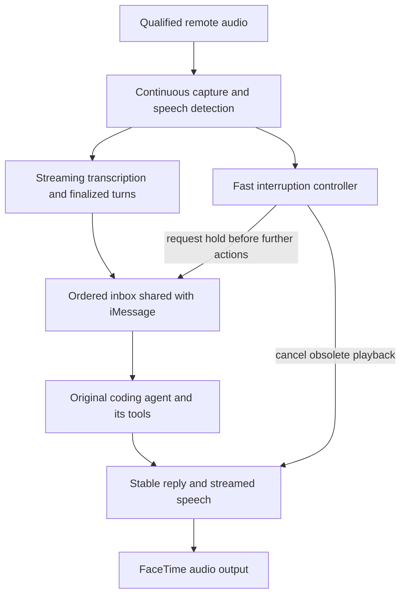

# iMessage-first control and two-way voice

Prepared November 13, 2026, America/New_York; implementation subsequently authorized
by the user. This extends [the improvements plan](FACETIMEOS_IMPROVEMENTS_PLAN.md)
beyond completed A–F. Source and installed components were subsequently deployed
as `7f1b687`; physical qualification remains pending and two-way voice is still
gated off. See [STATUS.md](STATUS.md) for the actual rollout evidence.

Implemented locally: T1 durable text commands/status/results; T2 selection and an
inbox for an already-running exact session; V0 bounded timing; V1–V2 gated continuous
capture and generation-safe interruption; V3 ordered final turns and stale-reply
suppression; V4 fresh-input guards and temporary speech holds; V5 channel-aware
replies and truthful captions. A shared TS/Python policy fixture checks negotiation.

Remaining: arbitrary idle-host wake, call-independent screen authority, T3 attachment
delivery, provider endpoint/threshold tuning and physical latency/echo acceptance.
The speech detector is sustained PCM energy, not semantic intent or echo cancellation.
Two-way voice is disabled by default and requires qualified remote-audio isolation
plus backend/media flags and the connector capability. See [STATUS.md](STATUS.md)
for validation and [GUIDE.md](GUIDE.md) for configuration.

## 1. Product decisions

- iMessage is the dependable default command channel. FaceTime provides optional
  live viewing; voice becomes the preferred in-call interaction only after the
  two-way path passes physical qualification. Text remains available during calls.
- The original coding session owns reasoning, tools, approvals and answers.
  Audio handling must continue independently while that agent is busy.
- An interruption stops speech promptly. A correction also holds future computer
  actions until the original agent processes it. An already submitted native
  action may finish or remain uncertain; never claim it was canceled without evidence.
- Keep Swift for Mac capture/input, Python for media/gateway and TypeScript for
  contracts/backend/connectors. Measure before changing a language or CUA default.
- Agent S is a possible future bounded specialist, not an approved replacement
  conversation owner. Do not execute arbitrary model-produced Python.

## 2. Baseline before this implementation

| Area                      | Source evidence                                                                                                                       | Consequence                                                                                                            |
| ------------------------- | ------------------------------------------------------------------------------------------------------------------------------------- | ---------------------------------------------------------------------------------------------------------------------- |
| Capture/playback coupling | `media/server.py`: `say()` calls `stop_stt()`; policy, audio sender, transcript acceptance, flush and delivery paths check `speaking` | Removing one guard cannot provide working full duplex. Audit the whole lifecycle.                                      |
| Existing streaming        | Deepgram streaming STT; TTS bytes streamed into LiveKit playback                                                                      | Replacing the provider alone does not repair turn ownership or interruption.                                           |
| Turn timing               | STT endpointing 400 ms, utterance-end fallback 1,000 ms; assembler settle 600 ms                                                      | Overlapping versus sequential waits need measurement. Do not add all configured values and call it measured latency.   |
| Connector delivery        | Active conversation polling checks at up to 500 ms intervals; agent must keep polling                                                 | The 20-second wait is a maximum, not a fixed delay. A busy agent can delay receipt much longer than the poll interval. |
| Native input              | Original chat's tool under `ExecutionCoordinator` ownership                                                                           | Tool internals and cancellation are host-dependent. Ownership does not guarantee immediate interruption of that tool.  |
| Fallback input            | Companion frame/action path; click/type/scroll schema                                                                                 | Existing code is reusable, but hotkeys/drag/file attachment operations are not all supported.                          |
| Fallback transport        | Foreground JSONL refuses image/input tools                                                                                            | Qualify an image-capable same-session MCP path before claiming custom fallback is usable.                              |
| Messages                  | `runtime.ts` routes text to one active request                                                                                        | Text-to-resume/start and call-independent input authority remain separate work.                                        |
| User result               | v2 has no automatic Messages completion effect; native sender is text-only                                                            | Explicit status/result routing and attachment delivery need implementation.                                            |

The November 12 speech repair is recorded as deployed but physically unqualified.
The A–F improvements are recorded as locally verified, not installed/deployed.
Refresh actual versions before a rollout; do not infer current service health.

## 3. First deliverable: dependable text control

### T1: Existing-session control

Use authenticated iMessage input and the existing exact-session inbox. Initially
retain the current active-request/call requirement for shared-screen control.
Text and final voice commands receive one server-assigned order. The same message
ID is processed once; two separately sent messages are not deduplicated merely
because their text matches. Neither channel silently takes priority over the other.

Add explicit outbound status/result policy: accepted, agent acknowledged, pending
approval, final result or unable to continue. Coalesce routine progress to avoid
message spam. Acknowledgment is not success. Every authorized send uses a durable
effect ID and receipt; ambiguous outcomes are reconciled rather than resent.
Destination comes from the verified pairing, never model-written recipient text.

### T2: Start/resume outside a call

Define an authenticated selection flow for a known, available session/project.
Report unavailable when the host cannot actually resume/wake that session. Do not
assume a local polling process can inject into any idle desktop chat. Multiple
sessions require explicit selection, never whichever terminal has focus.

Call-independent computer input requires an explicit device/session control grant,
short expiry, local policy and exclusive ownership. Do not remove current connected
call checks to simulate support. Design this additive authority separately; until
qualified, request an authorized viewing call before shared-screen input.

### T3: File result

Qualify search → preview → exact selected file → bound recipient → attachment
receipt → handset opens correct document. Initially use a disposable PDF and a
specifically authorized destination. If adding an attachment adapter, bound file
size/type and file identity, prevent path substitution between selection/send,
define temporary-file cleanup, and preserve uncertain sends. File contents and
paths do not enter diagnostic exports. No automatic screenshot attachments.

## 4. Voice design: two independent loops

The fast loop runs within media and does not wait for a model, connector poll or
computer action. It handles capture, speech activity and audio cancellation. The
slow loop handles finalized commands, reasoning and tools. No second conversational
LLM is necessary. Optional VAD/turn-detection models are narrow audio components.

### V0: Establish timing and capability baseline

Extend existing bounded diagnostics with audio generation, utterance ID, turn ID,
reply ID, action ID and process clock scope. Measure speech onset/end, STT boundary,
turn commit, connector acknowledgment, model/tool intervals when observable,
ownership acquisition, frame capture/receipt, input submission/observation, TTS
first byte and first/last media frame. Keep hidden host stages explicitly unknown.

Measure text and voice on the same synthetic workflow to isolate audio overhead.
Separate actual computer response from when the phone displays a new screen frame.
Record event-loop stalls, queue depth and provider/network waits; no raw audio,
screens, transcripts, credentials or filesystem paths in diagnostic logs.

### V1: Continuous authorized input

Split capture authorization from playback state. During a qualified v2 call keep
the remote track and STT stream active while speaking. Mute, revocation, stale
policy, wrong publisher, local Stop and call end still stop capture immediately.
Audit every `speaking` gate; do not weaken track identity or permission checks.

Maintain separate capture and playback generations. Starting/canceling TTS advances
playback generation only; it must not reset valid incoming utterances. Actual
capture teardown invalidates its generation, and callbacks from it are refused.
Retain pre-speech audio only in a small bounded transient buffer when needed.

Map the audio path first: which received track contains handset audio, whether
agent playback is digitally mixed into it, and what acoustic echo remains in
speakerphone/headset modes. Use supported echo cancellation with a playback
reference where available. Do not presume FaceTime or LiveKit removes all echo;
transcript matching alone is insufficient. If isolation fails, retain text control
and label voice degraded rather than execute possible self-generated commands.

### V2: Interrupt playback without losing the next instruction

Use qualified speech activity with calibrated duration/confidence, not one loud
sample. Immediately suspend or cancel current playout locally; cancel upstream
TTS generation, flush application and SDK audio queues, and reject late chunks
by playback generation. Already transmitted audio cannot be recalled; measure the
remaining audible tail separately on the handset.

Assign each interruption a stable ID bound to the active call, reply and generation.
Report cancellation once with the known published-audio extent. Server publication
does not prove what the handset heard. Keep one reply receipt per turn; do not
replay interrupted speech under a new ID. A requested repeat is a new human turn.

Distinguish candidate activity from finalized intent. Noise/backchannels may pause
audio but never authorize a task or cancel a completed effect. Initial conservative
policy: do not automatically replay canceled speech after a false interruption;
show listening and let the agent handle the next final turn. Measure false positives
before adding adaptive backchannel handling.

### V3: Complete utterances and corrections

Preserve interim/final boundary handling, shrinking-window regressions and bounded
assembly. Provisional words update captions only; they cannot authorize a send,
click or shell action. Tune endpointing/settle waits against both short commands
and mid-sentence pauses. A missing provider boundary times out visibly as incomplete;
it does not turn a partial command into executable text.

New final input advances conversation revision and invalidates stale queued replies.
Represent corrections as new ordered turns with an optional validated reference
to the earlier turn; never overwrite history or revive a terminal turn. Keep
backend acceptance distinct from acknowledgment by the coding agent.

For example: while the agent says “I found two files,” the user says “Wait, use the
older one.” Playback stops; the utterance continues to be captured; its final text
enters the same inbox; future conflicting actions remain held until the original
agent acknowledges the correction and checks current state.

### V4: Hold future actions while the agent is busy

Add a bounded interrupt/hold signal separate from ordinary turn processing. A
candidate speech event may temporarily hold new conflicting actions; only a final
command can direct different work. Define expiry and visible recovery for a
noise-only hold so silence cannot freeze execution indefinitely or approve a task.

Gate ClawdTime-controlled input at actual dispatch against current revision, hold,
executor epoch, fresh frame and local policy. A queued “send” planned before a
correction must fail that gate. A dispatched send/input remains in reconciliation.

For native tools, require a pre-dispatch check and supported host cancellation where
available. A check alone cannot close the race between check and native dispatch.
If the host cannot revoke execution, report “Pause requested; current action may
finish.” Do not qualify immediate action cancellation on that surface. Unknown
input blocks transfer to another executor and cannot be resolved by clearing state.

Existing agent polling remains the compatibility baseline. Evaluate a supported
notification/wakeup mechanism only for verified client versions. Backend long
polling can reduce empty requests but cannot interrupt a host blocked in a tool.
Never promise unsolicited chat injection or reset/replace the live session.

### V5: Speech scheduling and presentation

Keep streaming TTS and short original-agent replies. Start audio after the reply
passes the latest revision/cursor check; recheck generation on every produced
chunk. Do not wait for an entire audio file or narrate every click. Use bounded
backpressure so a stalled receiver cannot accumulate obsolete speech.

Show listening, processing, speaking-and-listening, muted, voice unavailable,
instruction accepted, agent acknowledged, and pause requested truthfully. A local
earcon or fixed receipt label can acknowledge transport promptly, but must not say
“done” or pretend to be the agent's answer. Do not add an extra narrator model.

## 5. Proposed latency budgets and acceptance

These are initial engineering goals, not measured results or a release promise.
Report median/p95, denominators, missing stages and failures for each scenario.
Use a shared monotonic clock for durations; cross-process observations require
clock-error bounds or one observer. Handset timing is a separate physical measure.

| Measurement                                            | Initial goal          | Boundary                                                         |
| ------------------------------------------------------ | --------------------- | ---------------------------------------------------------------- |
| Qualified speech-onset detection → media queue cleared | p95 ≤250 ms           | One media process; excludes detection and handset buffering      |
| Actual user onset → audible playback stops             | p95 ≤500 ms           | Physical handset observation; requires its own measurement       |
| End of a complete short utterance → committed turn     | p95 ≤1,200 ms         | Test pauses/corrections before tightening                        |
| Committed turn → delivery to already-waiting connector | p95 ≤500 ms           | Excludes busy host/model scheduling; report that separately      |
| Reply accepted → first audio published                 | p95 ≤800 ms           | Provider/network included; not proof of handset audibility       |
| Text received → acceptance indication                  | p95 ≤1 second locally | Carrier delivery measured separately; native sends may exceed it |

End-to-end instruction-to-action has no honest fixed budget until agent/tool stages
are measured. Report it for each task instead of hiding it behind fast acknowledgments.

Deterministic tests must cover: input during TTS generation/playback; late chunks
after cancellation; repeated interruptions; noise-only events; echo replay;
shrinking/final windows; correction before/after input dispatch; mixed text/voice
ordering; native cancellation refusal; pending approval; duplicate events;
stale publisher/generation; mute/Stop/end; bounded queues; restart and unknown effects.

Physical pilot gate: at least three fresh calls with ten scripted turns each,
including speech during playback, correction during a slow action, “stop,” pauses,
speakerphone/headset conditions, text during speech, and explicit cleanup. Add one
separately scoped call over ten minutes. Record each lost/duplicated turn, false
interruption, stale action and unexplained gap. Require zero lost scripted commands,
zero duplicate/unauthorized actions, zero stale speech after confirmed cancellation
beyond measured in-flight tail, and no unaccounted call/control cleanup. If any
case fails, retain experimental voice status. This is a pilot gate, not production
reliability evidence; broader network/device/reconnect cohorts remain necessary.

## 6. CUA performance and language decision

“Native” describes the tool supplied by the agent host, not a promise of semantic
UI access. It may use screenshots, accessibility data or browser DOM. FaceTimeOS
uses a screenshot/model/PyAutoGUI loop. ClawdTime fallback also uses screenshots,
but executes bounded input through the Swift helper. No speed winner is established.

Benchmark paired runs: identical device, app state, tasks and display geometry;
record model/provider and warm/cold state. Compare native versus qualified fallback
on click, type, scroll, file selection and attachment. Report missing capabilities
instead of silently substituting tools. Separate perception, model, tool, transport,
observation and phone-render times; repeat at least ten trials per supported task
and report failures. Optional Agent S trials are isolated and cannot share input
ownership. Preserve host restrictions and approvals in every comparison.

Prefer filesystem/API/DOM operations for tasks they express accurately; use visual
input when required. Keep sequential observation for state-dependent actions.
Only batch independent safe operations, and never remove freshness checks or
post-action verification to make the benchmark faster.

Python asyncio is suitable for streaming network orchestration. Profile event-loop
lag and CPU time before changing it. Move blocking I/O off the audio event loop;
CPU-heavy image/audio transforms need measured isolation via processes or native
libraries rather than assuming threads remove Python execution limits. Keep OS
capture/input in Swift. A TypeScript/Rust rewrite cannot eliminate model waits,
provider latency or the current stop-listening policy.

## 7. Implementation sequence and ownership

1. Lead defines revision/hold/playback contracts, compatibility and privacy bounds;
   instrument V0 and establish T1 text behavior first.
2. Media specialist prototypes V1–V2 behind an explicit v2 capability/feature flag.
   Compare a small in-place audio controller with supported LiveKit turn-handling
   components using synthetic tests; do not add another conversational agent or
   assume cloud-only capabilities are available in the current deployment.
3. Transport specialist implements ordered text/voice revision and receipt behavior;
   connector specialist integrates V3–V4, source skill and honest native limitations.
   Lead integrates shared contracts, dispatch gates and text-result policy.
4. Complete V5, deterministic race/fault tests, CUA timing comparison and updated
   operator acceptance checklist. Apply existing AGENTS file ownership.
5. In a separately authorized rollout, match backend/media/connector capabilities,
   canary on the intended paired session, then run the physical matrix. Unsupported
   versions retain labeled half-duplex or text mode. Do not change an active call's
   protocol or transfer the live line.
6. Promote voice default only when physical gates pass. T2/T3 are tracked product
   deliverables with their own session/file acceptance, not prerequisites for the
   first continuous-audio prototype.

Rollback stops new admission, ends/reconciles owned calls and preserves all receipts,
cursors and unknown outcomes; it never restores stale databases or replays sends.
No installed-component changes, calls or deployments are performed by this plan.

Likely files: `media/{server,utterances,playback,policy,captions,speech_diagnostics}.py`,
`src/{contracts,app,runtime}.ts`, `src/attention/conversation.ts`,
`src/control/{execution,coordinator,panel}.ts`, `src/transport/` status/effect adapters,
`connectors/shared/{conversation,client,setup-session}.ts`, source skill, Mac panel
labels and corresponding existing tests. Shared contracts/manifests remain lead-owned.

Validation uses `npm run check`, existing isolated media/gateway suites and relevant
Swift tests when the panel/helper changes. Do not execute a real connector spike,
provider benchmark or competitor service merely to validate a documentation change.

## 8. References and reuse boundaries

- [Deepgram endpointing and final segments](https://developers.deepgram.com/docs/understand-endpointing-interim-results): provider final segments and end-of-utterance boundaries are distinct; interim text can change.
- [LiveKit turn handling](https://docs.livekit.io/agents/logic/turns/): evaluate existing interruption/turn components, pinned to compatible installed versions.
- [LiveKit noise/echo handling](https://docs.livekit.io/cloud/noise-cancellation/): deployment/track compatibility must be checked; no cloud capability is presumed provisioned.
- [Python asyncio blocking work](https://docs.python.org/3/library/asyncio-task.html#asyncio.to_thread): distinguish blocking I/O from CPU work when protecting the audio loop.
- [FaceTimeOS audio interruption](https://github.com/dylanelu/FaceTimeOS/blob/97745aa62d37923a8dc8ccc5168a36797975bf65/backend/call.py), [utterance processing](https://github.com/dylanelu/FaceTimeOS/blob/97745aa62d37923a8dc8ccc5168a36797975bf65/backend/main.py), and [Agent S loop](https://github.com/dylanelu/FaceTimeOS/blob/97745aa62d37923a8dc8ccc5168a36797975bf65/Agent-S/src/s3/app.py): source mechanisms, not comparative latency or production qualification.

Borrow designs; inspect each file's provenance/license before copying code. The
reviewed FaceTimeOS Agent-S/frontend licenses do not establish backend licensing.
